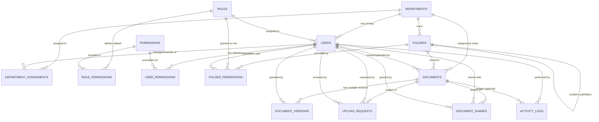

# Database Architecture & Entity-Relationship (ER) Documentation

## 1. Architecture Overview

The Department-Based Document Management System (DMS) uses a normalized relational architecture configured for **MySQL (InnoDB engine, utf8mb4 encoding)**. 

### Core Architectural Principles:
1. **Document Identity vs Physical Version Separation (Spec §20):**
   - The `documents` table retains permanent metadata (permanent Document ID, title, objective, owner, department, folder, status, recycle bin status).
   - The `document_versions` table stores each physical revision (version number, storage path, file size, mime type, checksum, uploader, timestamp, revision notes).
2. **Hybrid RBAC + Individual Overrides (Spec §4):**
   - Standard roles (`Super Administrator`, `Administrator`, `Manager`, `Employee`) define baseline privileges via `roles` and `role_permissions`.
   - `user_permissions` allows granular individual overrides with explicit `GRANT` or `DENY` policies to prevent accidental privilege leakage.
3. **Department Hierarchy & Folder-Level Security (Spec §5 & §10):**
   - Departments represent top-level organizational entities with quota controls and designated managers.
   - Folders support self-referential subfolder hierarchies (`parent_id`) with configurable permissions (`folder_permissions`).
4. **Approval & Review Lifecycle (Spec §8 & §9):**
   - `upload_requests` manages submission reviews with explicit status tracking (`PENDING`, `APPROVED`, `REJECTED`), reviewer associations, timestamps, and reason logs.
5. **Traceable Audit & Internal Sharing (Spec §14 & §16):**
   - `activity_logs` stores immutable system-wide event trails (user, action, target object, client IP, outcome).
   - `document_shares` facilitates secure internal document-level access with optional expiration dates and permission scopes (`VIEW`, `DOWNLOAD`, `EDIT`).

---

## 2. Entity-Relationship (ER) Diagram

---

## 3. Entity Specification Table

| Entity Name | Primary Key | Key Foreign Keys | Purpose |
|---|---|---|---|
| **`roles`** | `id` (Auto) | - | Defines system roles (Super Admin, Admin, Manager, Employee). |
| **`permissions`** | `id` (Auto) | - | Granular system actions (e.g. `doc:upload`, `doc:approve`, `doc:delete`). |
| **`role_permissions`** | `id` (Auto) | `role_id`, `permission_id` | Maps permissions to default roles. |
| **`departments`** | `id` (Auto) | `manager_id` -> `users.id` | Departments with code, storage quotas, and status. |
| **`users`** | `id` (Auto) | `role_id`, `primary_department_id` | Custom user model inheriting `AbstractBaseUser` & `PermissionsMixin`. |
| **`department_assignments`** | `id` (Auto) | `user_id`, `department_id` | Allows Admins or Managers to access multiple departments. |
| **`user_permissions`** | `id` (Auto) | `user_id`, `permission_id` | Individual `GRANT` or `DENY` overrides per user. |
| **`folders`** | `id` (Auto) | `department_id`, `parent_id` (Self) | Folder and subfolder hierarchy within a department. |
| **`folder_permissions`** | `id` (Auto) | `folder_id`, `role_id`, `user_id` | Folder-level access control list (ACL). |
| **`documents`** | `id` (UUID / VarChar) | `department_id`, `folder_id`, `created_by` | Permanent metadata identity, title, objective, owner, status, 30-day recycle bin fields. |
| **`document_versions`** | `id` (Auto) | `document_id`, `uploaded_by` | Physical file versions, storage paths, file sizes, mime types, checksums. |
| **`upload_requests`** | `id` (Auto) | `document_id`, `submitted_by`, `reviewed_by` | Approval queue for employee-submitted files with review notes. |
| **`document_shares`** | `id` (Auto) | `document_id`, `shared_with_id`, `granted_by_id` | Internal peer sharing with access levels and expiration dates. |
| **`activity_logs`** | `id` (Auto) | `user_id`, `document_id` | Audit trail recording user, action, client IP, timestamp, and result. |
